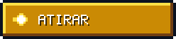
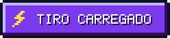
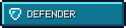

<h1 align="center">
  You're welcome to my GitHub profile! You're in the right place! ✅
</h1>

  

  
  
  
  
  

---

 
  
  
  
  
  
  

---

<!-- BOSS:START -->
<h2 align="center">⚔️ Boss Battle</h2>

  

  <a href="https://github.com/helviocarvalho13/helviocarvalho13/issues/new?title=boss%7Catirar&amp;body=%21%5BCarregando%5D%28https%3A%2F%2Fraw.githubusercontent.com%2Fhelviocarvalho13%2Fhelviocarvalho13%2Fmain%2Fgame%2Floading.svg%29%0A%0A%2A%2A%F0%9F%94%AB%20Atirar%21%2A%2A%20Clique%20em%20%2A%2ACreate%2A%2A%20%28ou%20%2ASubmit%20new%20issue%2A%29%20para%20enviar%20sua%20jogada.%20N%C3%A3o%20precisa%20escrever%20nada.%0A%0AEm%20cerca%20de%201%20minuto%20o%20rob%C3%B4%20responde%20aqui%20e%20o%20%5Bperfil%5D%28https%3A%2F%2Fgithub.com%2Fhelviocarvalho13%29%20%C3%A9%20atualizado."></a>
  <a href="https://github.com/helviocarvalho13/helviocarvalho13/issues/new?title=boss%7Ccarregar&amp;body=%21%5BCarregando%5D%28https%3A%2F%2Fraw.githubusercontent.com%2Fhelviocarvalho13%2Fhelviocarvalho13%2Fmain%2Fgame%2Floading.svg%29%0A%0A%2A%2A%E2%9A%A1%20Tiro%20carregado%21%2A%2A%20Clique%20em%20%2A%2ACreate%2A%2A%20%28ou%20%2ASubmit%20new%20issue%2A%29%20para%20enviar%20sua%20jogada.%20N%C3%A3o%20precisa%20escrever%20nada.%0A%0AEm%20cerca%20de%201%20minuto%20o%20rob%C3%B4%20responde%20aqui%20e%20o%20%5Bperfil%5D%28https%3A%2F%2Fgithub.com%2Fhelviocarvalho13%29%20%C3%A9%20atualizado."></a>
  <a href="https://github.com/helviocarvalho13/helviocarvalho13/issues/new?title=boss%7Cdefender&amp;body=%21%5BCarregando%5D%28https%3A%2F%2Fraw.githubusercontent.com%2Fhelviocarvalho13%2Fhelviocarvalho13%2Fmain%2Fgame%2Floading.svg%29%0A%0A%2A%2A%F0%9F%9B%A1%EF%B8%8F%20Defender%21%2A%2A%20Clique%20em%20%2A%2ACreate%2A%2A%20%28ou%20%2ASubmit%20new%20issue%2A%29%20para%20enviar%20sua%20jogada.%20N%C3%A3o%20precisa%20escrever%20nada.%0A%0AEm%20cerca%20de%201%20minuto%20o%20rob%C3%B4%20responde%20aqui%20e%20o%20%5Bperfil%5D%28https%3A%2F%2Fgithub.com%2Fhelviocarvalho13%29%20%C3%A9%20atualizado."></a>

Clique numa ação, confirme a Issue e volte aqui em cerca de 1 minuto. Todo mundo luta junto contra o mesmo chefe!

<b>🏆 Ranking, últimas jogadas e chefes derrotados</b>

 

_Ninguém lutou ainda. Seja o primeiro!_

**Últimas jogadas**

- _Nenhuma jogada ainda._

**Chefes derrotados**

- _Nenhum chefe derrotado ainda._

<!-- BOSS:END -->

  <picture>
    <source media="(prefers-color-scheme: dark)" srcset="https://raw.githubusercontent.com/helviocarvalho13/helviocarvalho13/output/github-contribution-grid-snake-dark.svg" />
    <source media="(prefers-color-scheme: light)" srcset="https://raw.githubusercontent.com/helviocarvalho13/helviocarvalho13/output/github-contribution-grid-snake.svg" />
    
  </picture>

---

  ⭐ 🍄 💰 <b>GAME OVER?</b> Never. The adventure continues... 🍄 💰 ⭐

